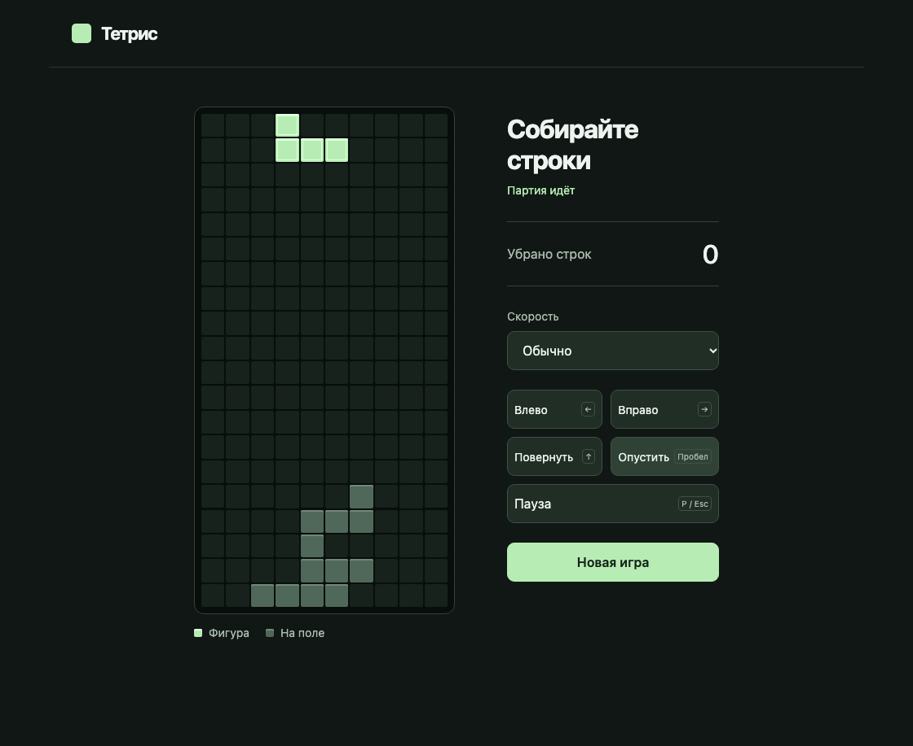
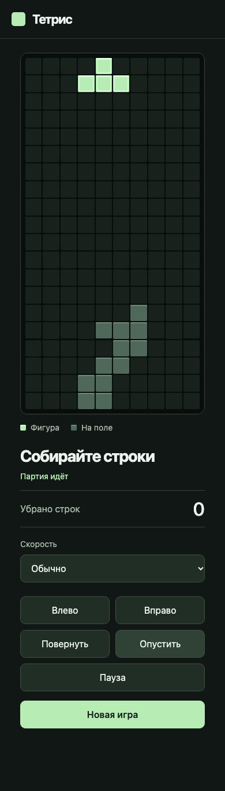
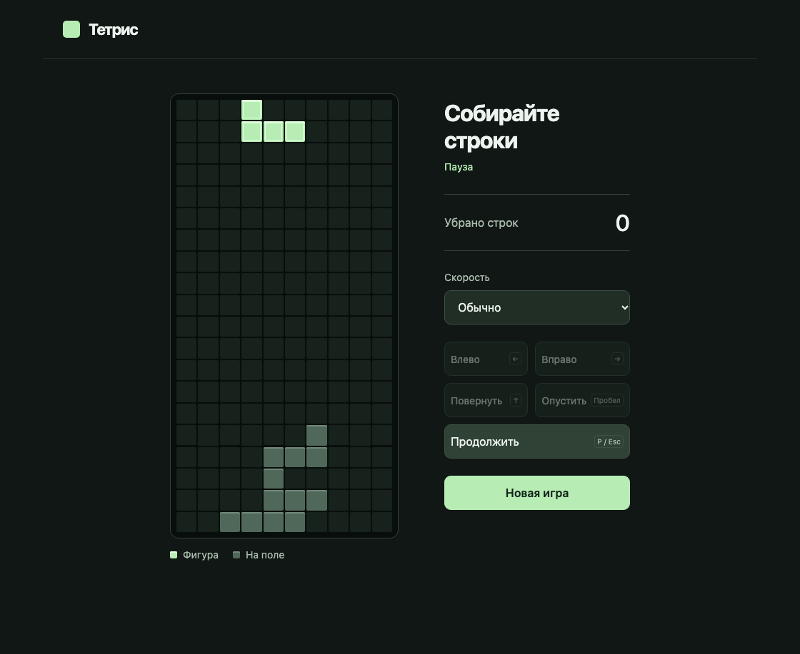
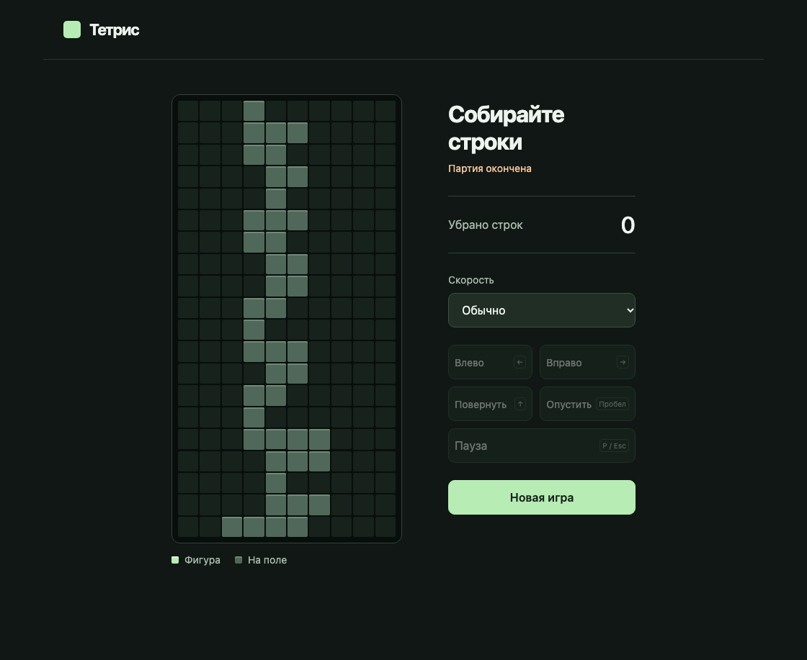
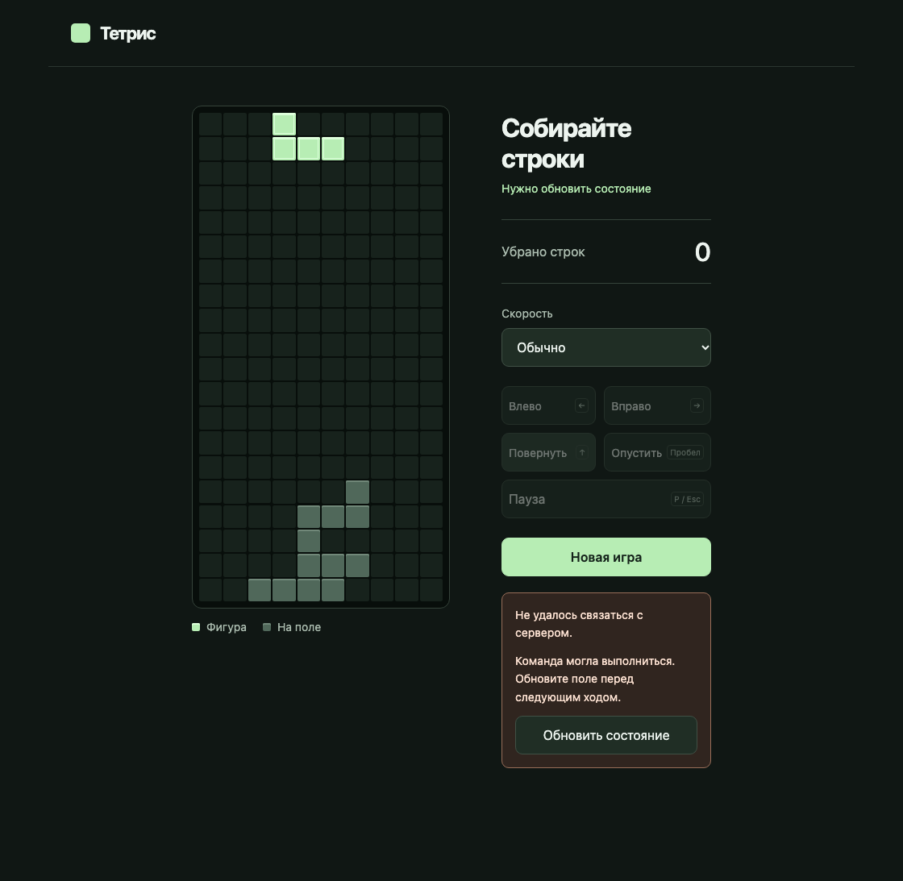
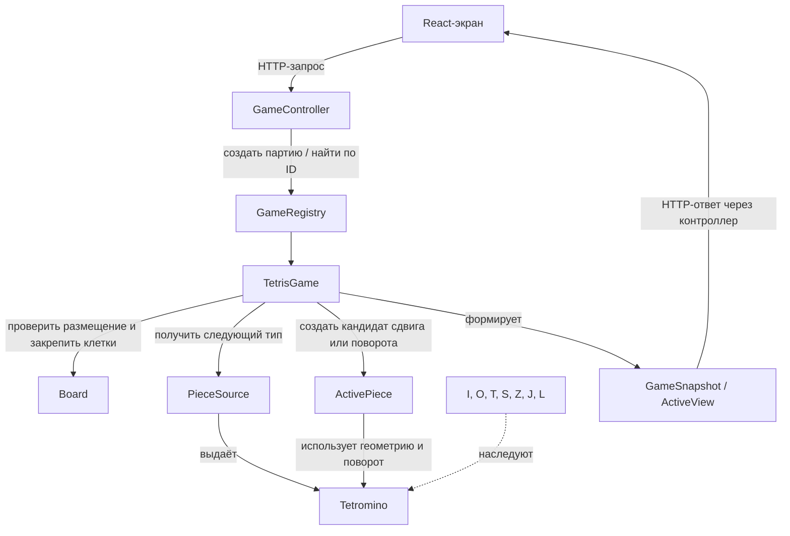

# Тетрис

Тетрис с ядром на Java, сервером Spring Boot и интерфейсом на React + TypeScript. Семь типов фигур падают на поле 10 × 20 клеток. Игрок сдвигает и поворачивает фигуры, чтобы заполнять строки. Скорость падения можно менять во время партии; кнопка «Пауза / Продолжить» останавливает и возобновляет игру.

## Как играть



Нажмите **«Новая игра»**. Фигура падает автоматически: сдвигайте её кнопками **«Влево» / «Вправо»** и меняйте положение кнопкой **«Повернуть»**. Кнопка **«Опустить»** сразу сбрасывает фигуру до препятствия и закрепляет её. В списке **«Скорость»** выберите удобный темп.

**«Пауза»** останавливает падение и отключает сдвиг и поворот. **«Продолжить»** возобновляет игру с выбранной скоростью. Пауза действует в текущей вкладке.

Светлая фигура — активная, приглушённые клетки — уже закреплённые. Полная строка исчезает и увеличивает счётчик. Если для новой фигуры нет места, партия заканчивается.

**Управление с клавиатуры:**

| Клавиша | Действие |
|---|---|
| `←` / `→` | Сдвиг |
| `↑` | Поворот |
| `Пробел` | Мгновенно опустить и закрепить |
| `P` / `Esc` | Пауза и продолжение |

На компьютере подсказки клавиш показаны на самих кнопках; на узком экране они скрыты. После начала партии фокус переходит на поле. Во время выбора скорости клавиши управляют списком; вернуться на поле можно щелчком или через Tab. Пробел на сфокусированной кнопке нажимает эту кнопку. `P` работает и на физической клавише `З` в русской раскладке.

<details>
<summary>Игра на телефоне</summary>

<p></p>

</details>

<details>
<summary>Игра на паузе</summary>



[Пауза на телефоне](docs/screenshots/game-mobile-paused.png)

</details>

<details>
<summary>Окончание партии</summary>



</details>

<details>
<summary>Сетевая ошибка и восстановление</summary>



</details>

## Сущности игры

| Сущность | Что знает | Что умеет |
|---|---|---|
| `TetrisGame` — партия | Поле, активную фигуру, источник следующих фигур, статус и число удалённых строк | Выполняет команды сдвига, поворота и мгновенного сброса, принимает допустимое размещение, закрепляет фигуру, выпускает следующую и определяет окончание игры. |
| `Board` — поле | Размеры сетки и расположение закреплённых клеток | Проверяет границы и пересечения, записывает закреплённые клетки, удаляет заполненные строки и опускает оставшиеся. |
| `ActivePiece` — активная фигура | Определение своего типа, локальные клетки и положение на поле | Вычисляет координаты клеток на поле и создаёт новое размещение при сдвиге или повороте. |
| `Tetromino` — определение типа фигуры | Идентификатор, четыре начальные клетки и центр поворота | Задаёт общий контракт геометрии и поворота. Классы `I`, `O`, `T`, `S`, `Z`, `J`, `L` наследуют этот контракт. `O` переопределяет поворот, сохраняя клетки на месте. |
| `PieceSource` — источник фигур | Контракт получения следующего типа | Выдаёт очередной `Tetromino`. Реализация `RandomPieceSource` хранит набор типов и генератор случайных чисел. |
| `PieceGeometry` — проверка геометрии | Инвариант четырёх разных клеток | Создаёт неизменяемую копию геометрии и проверяет её единым способом для определения фигуры, размещения и поля. |
| `Cell` — клетка | Неизменяемые координаты `x` и `y` | Создаёт клетку со смещёнными координатами для расчёта размещения фигуры. |
| `GameSnapshot`, `ActiveView` — снимок состояния | Размеры поля, статус партии, закреплённые клетки, активную фигуру и счётчик строк | Передают состояние потребителю через неизменяемые значения и коллекции. Старый снимок сохраняет данные при последующих ходах. |
| `GameRegistry`, `GameController` — доступ к партиям | Реестр сопоставляет идентификаторы с партиями, контроллер использует реестр | Создают партии, находят их для чтения и команд, возвращают снимки по HTTP. |
| React-экран | Последний полученный снимок, выбранную скорость, локальную паузу и состояние запроса | Отображает поле, передаёт команды кнопок и клавиатуры, управляет автоматическим падением и паузой, показывает ошибки. |

## Взаимодействие сущностей



1. Кнопка или горячая клавиша отправляет команду сдвига, поворота либо `HARD_DROP`. Мгновенный сброс находит посадку и сразу закрепляет фигуру. Таймер экрана отправляет `DOWN` с выбранным интервалом. Контроллер находит партию через реестр и передаёт ей команду.
2. `TetrisGame` получает от `ActivePiece` новое размещение и проверяет его через `Board.canPlace`. При повороте активная фигура обращается к своему `Tetromino`.
3. Если размещение допустимо, партия принимает его. Если боковой сдвиг или поворот заблокирован, положение фигуры сохраняется.
4. Если шаг вниз невозможен, партия сначала получает и подготавливает следующую фигуру. Ошибка источника оставляет текущее состояние партии без изменений. Затем `Board` закрепляет текущие клетки, удаляет заполненные строки и опускает строки над ними. Партия обновляет счётчик удалённых строк.
5. `TetrisGame` проверяет стартовую позицию подготовленной фигуры на обновлённом поле. Если фигура помещается, она становится активной. Иначе партия завершается.
6. Партия формирует снимок результата команды. Контроллер возвращает его экрану для отображения.

Абстракция и наследование позволяют представить семь типов через общий `Tetromino`. Полиморфизм оставляет особенности поворота внутри типа фигуры. Для подключения нового типа достаточно создать наследника и добавить его в набор источника. Логика партии продолжает работать через общий контракт.

Инкапсуляция основана на приватной сетке поля и неизменяемых размещениях и снимках. Инвариант четырёх разных клеток проверяет `PieceGeometry`. Проверка границ и занятости сосредоточена в `Board.canPlace` и используется при появлении, перемещении, повороте и закреплении фигуры.

Подробный [разбор игрового потока в коде](docs/game-flow.md): от кнопки «Новая игра» до выполнения команды и обновления поля.

## Запуск

Нужны JDK 21, Node 26.13.1 и Python 3 для проверки отчёта покрытия. Maven 3.9.11 загружается через Wrapper. Первый запуск требует доступа к Maven Central и npm registry.

```sh
make install
make check
```

В двух терминалах из корня проекта выполните команды.

```sh
make api
```

```sh
make web
```

Откройте [локальный экран](http://127.0.0.1:5173). API работает на порту 8080, Vite перенаправляет запросы /api. Нажмите «Новая игра». Кнопки сдвигают и поворачивают фигуру, таймер выполняет падение. Скорость можно менять во время партии. По умолчанию интервал равен 700 мс. При сетевом сбое падение останавливается до успешного обновления состояния.

Партии хранятся в памяти процесса. Перезапуск сервера удаляет партии.

## API и Swagger

После `make api` откройте [Swagger UI](http://127.0.0.1:8080/swagger-ui.html). Контракт работающего бэка доступен в [JSON](http://127.0.0.1:8080/v3/api-docs) и [YAML](http://127.0.0.1:8080/v3/api-docs.yaml).

Контракт проходит цепочку **Java → OpenAPI → TypeScript-клиент → React**. Из [docs/openapi.yaml](docs/openapi.yaml) генерируются [методы API](frontend/src/api/generated/api.gen.ts) и [модели](frontend/src/api/generated/models/index.ts). React вызывает `createGame()`, `readGame(id)` и `executeCommand(id, body)`; URL, HTTP-методы и поля моделей вручную не дублируются.

После изменения API обновите контракт и клиент из корня проекта:

```sh
make api-generate
```

Команда экспортирует схему из временного бэка на свободном порту, завершает его и запускает Orval. Для генерации только клиента из сохранённого YAML выполните `cd frontend && npm run api:generate`; работающий бэк не нужен. Отдельный экспорт схемы остаётся доступен через `make openapi`.

`make check` сверяет runtime с YAML и YAML со сгенерированными файлами. Отдельные запуск и сборка фронта также проверяют SDK; при расхождении выводится команда обновления. Сгенерированные файлы вручную не редактируются. Общий [транспорт](frontend/src/api/http.ts) отвечает за таймаут и ошибки. В браузере генератор не запускается.

В текущую схему включены маршруты `/api/games/**`. Чтобы новый контроллер попал в клиент, его операции сначала должны появиться в OpenAPI.

Для отключения документации запустите JAR с параметрами `--springdoc.api-docs.enabled=false --springdoc.swagger-ui.enabled=false`. Игровой API продолжит работать.

## Логирование

API пишет создание и окончание партии на `INFO`, результаты команд на `DEBUG`, неизвестный UUID и отсутствующую команду на `WARN`, неожиданные сбои на `ERROR` со стеком. События содержат `gameId`, а результаты команд — действие, результат и счётчик строк. По умолчанию включён `INFO`, поэтому автоматические шаги не заполняют журнал.

Для подробного журнала запустите сервер так:

```sh
LOGGING_LEVEL_DEV_TETRIS_API=DEBUG make api
```

При сбое операции единый обработчик записывает ERROR со стеком и контекстом, а клиент получает HTTP 500 в формате `problem+json` без внутренних деталей.

Локальная пауза не отправляет запрос на сервер, поэтому её переключения не записываются в журнал API.

## Проверки

```sh
make check
```

Сборка проекта, Java- и React-тесты, проверка типов, стиля кода, JavaDoc и покрытия.

```sh
cd frontend && npx playwright install chromium
cd .. && make e2e
```

Браузерные тесты игрового цикла, адаптивности, восстановления после сетевой ошибки и выполнения запросов через Swagger UI. Тестовые серверы запускаются и останавливаются автоматически.

```sh
make javadoc
```

Генерация HTML-документации Java-кода и тестов. Результат находится в каталогах `backend/core/target/reports` и `backend/api/target/reports`.
