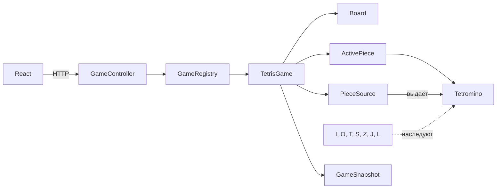

# Ядро «Тетриса» на ООП

Цель ядра — выполнять правила игры независимо от способа отображения. Размер поля по умолчанию равен 10 × 20. Команды перемещения и поворота проверяются до изменения активной фигуры. Мгновенный сброс опускает фигуру до препятствия и сразу закрепляет. Заблокированный шаг вниз закрепляет фигуру, удаляет заполненные строки и выпускает следующую.

## Объекты и связи

| Объект | Данные | Действия и взаимодействие |
|---|---|---|
| TetrisGame | Поле, активная фигура, источник, статус, счётчик строк и UUID | Принимает команду, вычисляет кандидата, спрашивает поле о размещении и применяет результат. При закреплении обновляет счётчик и выпускает следующую фигуру. Под одной блокировкой формирует результат и снимок. |
| Board | Размеры и приватная сетка закреплённых клеток | Единая canPlace проверяет границы и занятость для появления, сдвига, поворота и закрепления. lock сначала проверяет фигуру, затем записывает клетки и удаляет все полные строки. |
| PieceGeometry | Инвариант четырёх разных клеток | Копирует и проверяет геометрию единым способом для Tetromino, ActivePiece и Board. |
| ActivePiece | Тип фигуры, неизменяемые локальные клетки и опорная точка | Переводит клетки в координаты поля. При сдвиге или повороте создаёт новый кандидат. Доступен внутри пакета ядра. |
| Tetromino | Идентификатор, начальная геометрия и центр вращения | Общий контракт фигуры. Наследники задают I, O, T, S, Z, J, L. O переопределяет поворот, сохраняя клетки. |
| PieceSource | Контракт получения очередного типа | RandomPieceSource выбирает тип из неизменяемого набора. Подмена источника позволяет воспроизводить тестовые последовательности. |
| GameSnapshot и ActiveView | Значения текущего состояния и неизменяемые списки клеток | Позволяют читать партию без доступа к её сетке. Старый снимок сохраняется при последующих командах. |
| GameRegistry | Потокобезопасное сопоставление UUID и партий | Создаёт независимую партию, находит существующую. Синхронизацию команд и чтений обеспечивает сама партия. |
| GameController | Реестр партий | Валидирует HTTP-ввод и возвращает JSON. ApiErrors преобразует ошибки в problem+json. |
| React App | Последний серверный снимок, запрос, ошибка и необходимость обновления | Отображает поле и отправляет действия. После неопределённого результата команды читает состояние через GET. |

## Принципы ООП

Абстракция представлена Tetromino и PieceSource. Наследование связывает семь типов с Tetromino. Полиморфизм позволяет вызывать поворот через тип фигуры, включая поведение O. Инкапсуляция основана на приватной сетке, внутреннем ActivePiece, неизменяемых определениях и копировании коллекций снимка.

Для нового типа нужно создать наследника Tetromino и добавить его в набор источника. TetrisGame и Board работают с клетками через общий контракт. Классы core во время выполнения используют только JDK.

## Последовательность шага

1. API передаёт команду партии.
2. Партия создаёт кандидат перемещения или поворота и вызывает Board.canPlace.
3. Допустимый кандидат становится активной фигурой. Недопустимый боковой ход или поворот возвращает BLOCKED.
4. При недопустимом DOWN партия сначала получает следующий тип и подготавливает стартовую геометрию. При ошибке источника состояние партии сохраняется. Затем поле закрепляет текущие клетки, удаляет полные строки и уплотняет остальные снизу вверх.
5. Партия проверяет подготовленную фигуру на обновлённом поле. Если она не помещается, статус становится GAME_OVER.
6. API возвращает снимок, сформированный внутри той же синхронизированной операции.

Опорная точка при повороте сохраняется. Дополнительных смещений у стен нет. Браузер автоматически отправляет DOWN с выбранным интервалом 1100, 700 или 350 мс. Кнопка «Пауза / Продолжить» управляет локальной остановкой таймера и игровых команд в текущей вкладке. Продолжение запускает полный выбранный интервал. Во время незавершённого запроса тик пропускается. При сетевой ошибке или завершении автопадение останавливается. Очки и уровни выходят за рамки этой версии.

Кнопки и клавиатура используют общий путь команд: ← / → — сдвиг, ↑ — поворот, Пробел — HARD_DROP, P / Esc — локальная пауза. HARD_DROP ищет посадку без промежуточного изменения партии и использует общее с DOWN закрепление. При ошибке следующего источника исходное размещение сохраняется.
